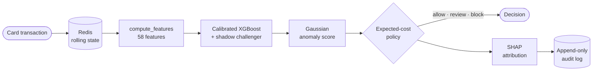
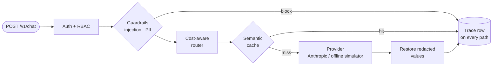
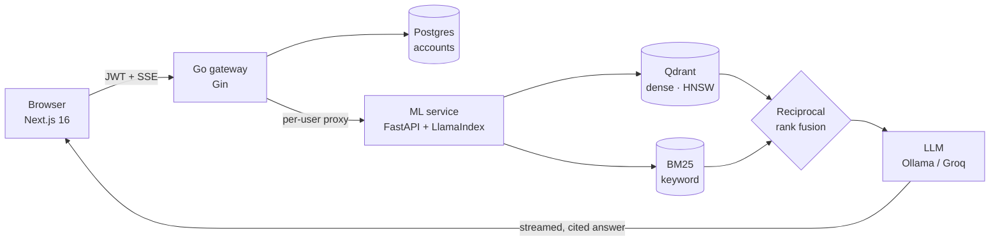
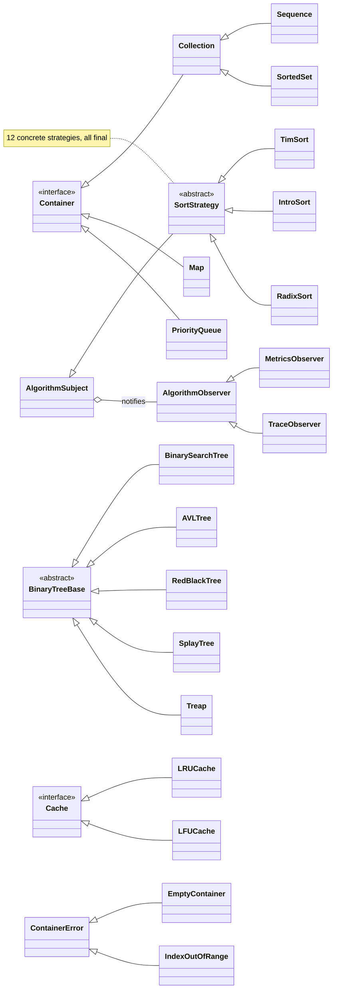
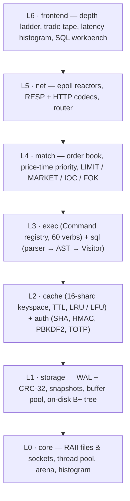

<div align="center">

<picture>
  <source media="(prefers-color-scheme: dark)" srcset="./assets/hero-dark.svg">
  <source media="(prefers-color-scheme: light)" srcset="./assets/hero-light.svg">
  
</picture>

<p>
  <a href="https://ayushsaini9876.github.io"></a>
  <a href="https://www.linkedin.com/in/ayush-saini-5aa0052a8/"></a>
  <a href="mailto:ayushkumarsiani@gmail.com"></a>
</p>

<p>
  <a href="https://codeforces.com/profile/Saini_Ayush"></a>
  <a href="https://leetcode.com/u/AYUSH_SAINI_9876/"></a>
  
</p>

<p>
  <a href="#ai-ml"></a>
  <a href="#systems-oop"></a>
  <a href="#full-stack"></a>
  <a href="#experience"></a>
  <a href="#competitive-programming"></a>
  <a href="#certifications"></a>
</p>

<picture>
  <source media="(prefers-color-scheme: dark)" srcset="./assets/metrics-dark.svg">
  <source media="(prefers-color-scheme: light)" srcset="./assets/metrics-light.svg">
  
</picture>

</div>

## 👨‍💻 About me

```ts
const ayush = {
  studies:      "B.S. (Hons.) Chemistry @ IIT Kharagpur · 2023 – 2027",
  builds:       ["ML systems you can audit", "LLM infrastructure", "low-latency C++", "real-time web apps"],
  languages:    ["C++20", "Python", "TypeScript", "Go", "SQL"],
  lastRole:     "Summer Associate – Tech Intern @ ReachIvy (May – Jul 2026)",
  askMeAbout:   ["fraud detection", "hybrid-search RAG", "matching engines", "WebRTC"],
  motto:        "measure it, test it, then ship it",  // chemistry taught me to measure twice
};
```

<a name="ai-ml"></a>

## 🤖 AI / ML systems

<table>
<tr>
<td width="50%" valign="top">

### 🛡️ [Argus](https://github.com/AYUSHSAINI9876/argus-fraud-detection)
**Real-time card-fraud detection with cost-aware decisions**

- Calibrated **XGBoost**: PR-AUC **0.972** vs **0.893** for a logistic baseline *(simulated data)*
- Every score becomes **allow / review / block** by expected cost, with a **SHAP** reason
- Gaussian anomaly detector written from scratch · shadow challenger · PSI drift checks
- **94 tests** in CI · FastAPI · Redis · PostgreSQL · Next.js 15

`Python` `XGBoost` `scikit-learn` `SHAP` `FastAPI` `Redis` `PostgreSQL`

</td>
<td width="50%" valign="top">

### 🧭 [Pharos](https://github.com/AYUSHSAINI9876/Pharos)
**Self-hosted LLM gateway: guardrails, caching, routing, evals**

- Prompt-injection classifier: precision **1.000**, recall **0.962** on a hand-written out-of-distribution set *(n = 52)*
- PII & secret redaction · two-level semantic cache · cost-aware model routing
- Bootstrap-CI eval harness · PSI + KS drift alerts · Argon2id, rotating JWTs, RBAC
- **282 tests** · 86% coverage · runs fully offline

`Python` `FastAPI` `scikit-learn` `SQLAlchemy` `Next.js` `Docker`

</td>
</tr>
<tr>
<td width="50%" valign="top">

### 🔎 [Axiom AI](https://github.com/AYUSHSAINI9876/axiom-ai)
**Multi-tenant hybrid-search RAG for scientific literature**

- Dense **Qdrant (HNSW)** + **BM25** retrieval, fused with reciprocal-rank fusion
- Streamed, cited answers over SSE · every account's corpus isolated
- **Go/Gin** gateway (JWT, refresh tokens, Postgres) → **FastAPI + LlamaIndex** ML service
- **81 tests** across Go, Python and Next.js 16 · CI green

`Go` `Python` `LlamaIndex` `Qdrant` `FastAPI` `Next.js`

</td>
<td width="50%" valign="top">

### 🛰️ [FrontierAtlas](https://github.com/AYUSHSAINI9876/frontier-atlas-pipeline)
**Fault-tolerant ingestion pipeline for an AI / venture intelligence graph**

- Startups, research papers, AI news and jobs from live public sources → one canonical schema
- 6-strategy entity resolution · every record traces back to a live source URL
- GraphQL alias batching: **25 API requests** where REST would need **1,952**
- **139 offline tests**, green on Python 3.10 – 3.12

`Python` `GraphQL` `ETL` `pytest`

</td>
</tr>
</table>

<details>
<summary><b>🔍 How Argus scores a transaction</b> — click to expand the pipeline</summary>
<br>



</details>

<details>
<summary><b>🧭 How a request flows through Pharos</b> — click to expand</summary>
<br>



</details>

<details>
<summary><b>🔎 Axiom AI architecture</b> — click to expand</summary>
<br>



</details>

<details>
<summary><b>➕ More AI work</b></summary>
<br>

- **[Empathy Engine](https://github.com/AYUSHSAINI9876/Empathy-Engine)**: emotion-aware text-to-speech. VADER sentiment plus keyword heuristics map each emotion to SSML rate, pitch and volume for neural voices *(FastAPI + React)*.

</details>

<a name="systems-oop"></a>

## ⚙️ Systems & OOP · C++20

<table>
<tr>
<td width="50%" valign="top">

### 🏦 [Bourse](https://github.com/AYUSHSAINI9876/Bourse) · [live demo ↗](https://bourse-mocha.vercel.app)
**A from-scratch trading exchange: zero third-party runtime dependencies**

- Price-time-priority **matching engine** (LIMIT / MARKET / IOC / FOK)
- Hand-written **epoll** reactors · speaks **RESP**, so `redis-cli` works against it
- **Storage engine**: write-ahead log (CRC-32, torn-tail recovery) · buffer pool · on-disk **B+ tree**
- **SQL**: recursive-descent parser → AST → **Visitor** → volcano iterators
- SHA-256 · HMAC · PBKDF2 · **TOTP 2FA** from scratch, checked against RFC test vectors
- **330 tests** · ASan / UBSan / TSan clean in CI

`C++20` `CMake` `epoll` `Docker` `Command` `Visitor` `Observer`

</td>
<td width="50%" valign="top">

### 🧩 [Daedalus](https://github.com/AYUSHSAINI9876/Daedalus)
**A C++20 data-structures & algorithms library with an object-oriented core**

- ~50 header-only structures behind a **polymorphic interface hierarchy**
- Design patterns: **Strategy** (12 interchangeable sorts), **Observer** (metrics & trace), exception hierarchy
- A from-scratch **HTTP/1.1 server** built on its own containers: router = trie, sessions = LRU cache, rate limiter = hash-map token buckets
- **374 unit tests** + 41 HTTP and 68 UI checks · zero dependencies · `-Werror` · CI on Linux, macOS and Windows

`C++20` `CMake` `OOP` `Strategy` `Observer` `RAII`

</td>
</tr>
</table>

<details>
<summary><b>🧩 Daedalus class hierarchy (OOP core)</b> — click to expand</summary>
<br>



</details>

<details>
<summary><b>🏦 Bourse layered architecture</b> — click to expand</summary>
<br>



</details>

<details>
<summary><b>➕ More systems work</b></summary>
<br>

- **[WorkFlowEngine](https://github.com/AYUSHSAINI9876/WorkFlowEngine)**: a .NET 8 minimal-API workflow engine. Define workflows, start instances and move them between states through validated actions *(C#)*.

</details>

<a name="full-stack"></a>

## 🌐 Full-stack & real-time

<table>
<tr>
<td width="50%" valign="top">

### 📹 [ZConnect](https://github.com/AYUSHSAINI9876/ZConnect) · [live ↗](https://z-connect-beige.vercel.app)
**Browser video calls: WebRTC mesh with Socket.IO signalling**

- Peer-to-peer video for small groups (≈ 2 – 6), screen sharing, real-time chat
- JWT-secured accounts · login rate-limiting (20 requests / 15 min / IP) · payload caps
- Deployed on Vercel + Render with MongoDB Atlas

`React` `MUI` `Node.js` `Express` `Socket.IO` `WebRTC` `MongoDB`

</td>
<td width="50%" valign="top">

### 🎙️ [ResumeAI](https://github.com/AYUSHSAINI9876/Resume-builder) · [live ↗](https://resume-builder-alpha-ten.vercel.app)
**A voice-controlled resume builder powered by Google Gemini**

- Dictate sections with in-browser speech recognition → Gemini polishes them
- PDF export · saved resumes in MongoDB · serverless API on Vercel

`React` `Node.js` `Express` `MongoDB` `Gemini`

</td>
</tr>
<tr>
<td width="50%" valign="top">

### 📈 [MarketPlus360](https://github.com/AYUSHSAINI9876/MarketPlus360)
**A Zerodha-style paper-trading platform**

- bcrypt + JWT auth · per-user holdings, positions, orders and funds
- ₹1,00,000 simulated ledger · every BUY / SELL instantly syncs every view
- Hardened Express API (helmet, rate limiting) · Chart.js dashboard

`React` `MUI` `Chart.js` `Express` `MongoDB`

</td>
<td width="50%" valign="top">

### 💸 [BalanceBox](https://github.com/AYUSHSAINI9876/BalanceBox)
**Split trip expenses with friends: always know who owes whom**

- Trips, shared expenses, multi-payer splits and a settlement balance matrix
- Email-OTP sign-up · JWT + bcrypt · category insights with Recharts

`React` `Recharts` `Express 5` `Mongoose` `JWT`

</td>
</tr>
</table>

<details>
<summary><b>➕ More full-stack work</b></summary>
<br>

- **[OpenSoft-2026](https://github.com/AYUSHSAINI9876/OpenSoft-2026)** *(team project)*: Oak Capital, a trading platform. My part was the React/TypeScript trading dashboard and charts, the Go market simulator and trading bots, and the Docker / GitHub Actions / Nginx delivery; teammates built the C++ matching engine and the Go core.
- **[CodeForge](https://github.com/AYUSHSAINI9876/CodeForge)**: GitHub-style repository and issue management *(MERN)*.
- **[Tria Contact List](https://github.com/AYUSHSAINI9876/Tria_Frontend_Developer_V2)**: an animated contact manager *(React, Vite, Framer Motion)*.
- **[Portfolio](https://ayushsaini9876.github.io)**: a single self-contained page, light and dark themes, no dependencies.

</details>

<a name="experience"></a>

## 💼 Experience

**Summer Associate – Tech Intern · [ReachIvy](https://www.reachivy.com)** (Reach Education Pvt. Ltd.) · Mumbai · May – Jul 2026<br>
Full-stack work on **HelloIvy**, an AI-assisted college-counselling platform: document intelligence, real-time LLM counselling modules, entitlements and multi-tenancy.
`Next.js` `TypeScript` `Django REST` `PostgreSQL`

## 🧰 Tech stack

<p align="center">
  <br>
  <br>
  <br>
  
</p>

<p align="center">
  
  
  
  
  
  
</p>

<a name="competitive-programming"></a>

## 🏆 Competitive programming

<div align="center">

| Platform | Handle | Best | Highlights |
|:--|:--|:--|:--|
|  | [Saini_Ayush](https://codeforces.com/profile/Saini_Ayush) | **Specialist · 1537** | **850th of 17,637** in Round 1045 (Div. 2) · 1,150+ solved |
|  | [AYUSH_SAINI_9876](https://leetcode.com/u/AYUSH_SAINI_9876/) | **1893** peak rating | **309th** in Weekly Contest 455 · top 7% · 1,000+ solved · 500-day badge |

<picture>
  <source media="(prefers-color-scheme: dark)" srcset="https://leetcard.jacoblin.cool/AYUSH_SAINI_9876?theme=dark&font=Fira%20Code&ext=heatmap&border=0">
  
</picture>
<picture>
  <source media="(prefers-color-scheme: dark)" srcset="https://codeforces-readme-stats.vercel.app/api/card?username=Saini_Ayush&theme=dark&force_username=true">
  
</picture>

</div>

## 📈 GitHub activity

<div align="center">
<picture>
  <source media="(prefers-color-scheme: dark)" srcset="https://github-readme-stats.vercel.app/api?username=AYUSHSAINI9876&show_icons=true&include_all_commits=true&count_private=true&hide_border=true&theme=github_dark">
  
</picture>
<picture>
  <source media="(prefers-color-scheme: dark)" srcset="https://github-readme-stats.vercel.app/api/top-langs/?username=AYUSHSAINI9876&layout=compact&langs_count=8&hide_border=true&theme=github_dark">
  
</picture>
<br>
<picture>
  <source media="(prefers-color-scheme: dark)" srcset="https://streak-stats.demolab.com/?user=AYUSHSAINI9876&hide_border=true&theme=github-dark-blue">
  
</picture>
</div>

<a name="certifications"></a>

## 📜 Certifications

| Certification | Issuer | Year | Verify |
|:--|:--|:--:|:--:|
| **Machine Learning Specialization** (3 courses) | DeepLearning.AI & Stanford Online · Coursera | 2026 | [✔ verify](https://coursera.org/verify/specialization/I92JFZQR4OQQ) |
| ↳ Supervised ML: Regression & Classification | DeepLearning.AI & Stanford Online | 2026 | [✔](https://coursera.org/verify/07XBZ3UPVUIT) |
| ↳ Advanced Learning Algorithms | DeepLearning.AI & Stanford Online | 2026 | [✔](https://coursera.org/verify/B74XTY8TAQ7E) |
| ↳ Unsupervised Learning, Recommenders, Reinforcement Learning | DeepLearning.AI & Stanford Online | 2026 | [✔](https://coursera.org/verify/RQTRKY9M5TWT) |
| **ICPSC S2: Certificate of Excellence** | AlgoZenith | 2025 | [✔ verify](https://maang.in/courses/certificate?id=AZ251552171881299) |
| **Delta: Full Stack Web Development** | Apna College | 2025 | — |

## 🎓 Education

**B.S. (Hons.) Chemistry, IIT Kharagpur** · 2023 – 2027<br>
JEE (Advanced) 2023: **All India Rank 21,313**, top 11.8% of the 180,372 who sat both papers · JEE (Main) 2023: **98.69 percentile**, AIR 15,417

## 🤝 Let's connect

<p align="center">
  <a href="mailto:ayushkumarsiani@gmail.com"></a>
  <a href="https://www.linkedin.com/in/ayush-saini-5aa0052a8/"></a>
  <a href="https://ayushsaini9876.github.io"></a>
  <a href="https://codeforces.com/profile/Saini_Ayush"></a>
  <a href="https://leetcode.com/u/AYUSH_SAINI_9876/"></a>
</p>

<picture>
  <source media="(prefers-color-scheme: dark)" srcset="./assets/footer-dark.svg">
  <source media="(prefers-color-scheme: light)" srcset="./assets/footer-light.svg">
  
</picture>
